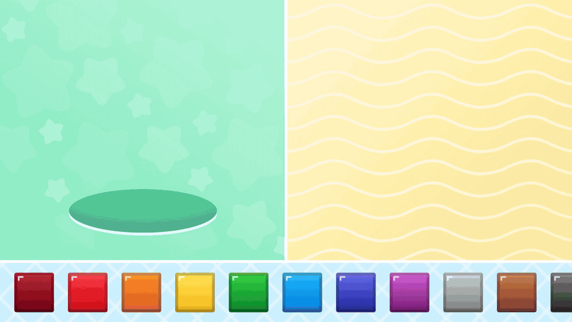

# Cube Tower — тестовое задание Unity Developer (JustMoby)

Мини-игра для детей: кубики из нижнего горизонтального скролла перетаскиваются вправо и строятся в башню,
а любой кубик башни можно выбросить в овальную дыру слева.

- **Unity:** 2022.3.62f3 (последняя 2022.3 LTS)
- **Платформа:** мобильная, landscape. Вёрстка проверена на 19.5:9, 16:9, 4:3, а также в портрете (9:19.5, 9:16, 3:4)
- **Стек:** UGUI, Zenject (Extenject), UniRx, UniTask, DOTween, Unity Localization
- **Фактически затраченное время:** 2 часа

## Видео геймплея



[Полное видео в 1080p (MP4)](Docs/gameplay.mp4). В ролике: подсказка прокрутки панели на старте, постройка
башни до верха экрана со случайными смещениями, сообщение об ограничении по высоте, промах со взрывом,
выброс кубиков в дыру с опусканием верхних, прокрутка панели свайпом и подсказка рукой при бездействии.

## Запуск

1. Открыть проект в Unity 2022.3.62f3. Пакеты подтянутся автоматически: Extenject, UniRx и UniTask ставятся из OpenUPM (scoped registry в `Packages/manifest.json`), Unity Localization — из реестра Unity.
2. Нажать Play в любой сцене. Редактор всегда стартует со сцены `Bootstrap`, переключается в меню **Cube Tower → Play From Bootstrap**.
3. Полезное в меню **Cube Tower**:
   - **Clear Saved Progress** — сброс сохранения;
   - **Open Saves Folder** — открыть папку с сохранением.

Бинарные ассеты хранятся в Git LFS. Перед клонированием нужен `git lfs install`.

## Геймплей

| Действие | Поведение |
|---|---|
| Кубик из скролла → правая зона (башня пуста) | Кубик встаёт в точку броска, позиция ограничивается границами зоны |
| Кубик → поверх башни | Кубик прыжком (DOTween) встаёт на вершину со случайным смещением по горизонтали, не больше 50% грани. Смещение также не выводит кубик за пределы зоны |
| Башня упёрлась в верх экрана | Кубик не ставится, показывается сообщение об ограничении |
| Промах | Кубик «взрывается» на осколки и исчезает |
| Кубик из башни → в дыру | Кубик поворачивается ромбом и погружается под овальную маску. Кубики выше плавно опускаются |
| Кубик из башни → мимо дыры | Кубик возвращается на своё место |
| Любой кубик из скролла → в дыру | Кубик выбрасывается |

### Туториал

- **Старт.** Через 0.6 с панель кубиков сама прокручивается вперёд и назад, а рука показывает свайп: так видно, что панель листается. Если игрок уже коснулся экрана, подсказка не показывается.
- **Бездействие.** После 5 с без касаний рука показывает следующее полезное действие и повторяет его, пока игрок бездействует:
  - пустая башня — перенести кубик из панели вправо;
  - башня растёт — по очереди «поставить кубик сверху» и «выбросить верхний кубик в дыру»;
  - башня упёрлась в верх — только «выбросить в дыру».
- **Как выглядит.** Палец касается верхней части кубика-источника, кубик подсвечивается (увеличивается до 110%), рука несёт его полупрозрачную копию. Перед каждым жестом рука ориентируется: наклоняется вокруг кончика пальца и при необходимости отражается, чтобы на всём пути целиком оставаться на экране при любом соотношении сторон.
- **Прерывание.** Любое касание или драг мгновенно прерывает подсказку, таймер бездействия сбрасывается.
- **Логика.** Выбор подсказки — чистый класс `TutorialHintPlanner`, покрыт тестами. Тайминги настраиваются в `GameplaySettings → Tutorial`.

Попадание в дыру считается по уравнению эллипса, а не по прямоугольнику. Каждое действие сопровождается
локализованным сообщением над нижней панелью. Физика не используется, все движения сделаны анимациями.

## Архитектура

Проект разбит на сборки (asmdef) с однонаправленными зависимостями:

```
CubeTower.Core      — доменная логика без MonoBehaviour: модель башни, правила, раскладка, сохранение, контракты
   ▲
CubeTower.Runtime   — представление и инфраструктура: views, DI-инсталлеры, ScriptableObject-конфиги, файловое хранилище
   ▲
CubeTower.Editor    — утилиты редактора
CubeTower.Tests.EditMode — 52 юнит-теста доменного слоя
```

```
Assets/_Project
├── Art            спрайты из Figma, атлас, материал шрифта
├── Configs        GameConfig, CubeSkinCatalog, GameplaySettings
├── Localization   Unity Localization: настройки, локали en / ru, таблица Messages
├── Prefabs        Cube, PaletteItem (вариант Cube)
├── Scenes         Bootstrap → Game
├── Scripts        Core / Runtime / Editor
└── Tests          EditMode
```

**Поток запуска.** `Bootstrap` параллельно загружает конфиг через `IGameConfigProvider` и инициализирует
локализацию (с предзагрузкой таблицы), затем открывает `Game`
через `ZenjectSceneLoader`, передавая конфиг в контейнер. В `Game` порядок старта задан явно в
`GameplayEntryPoint`: восстановление прогресса → построение башни → построение палитры → автосохранение.

**Модель → вид.** `TowerModel` хранит состояние в единицах «длина грани кубика»: позицию основания и смещения
кубиков относительно нижнего. Состояние не зависит от разрешения, поэтому одно и то же сохранение корректно
раскладывается на любом экране. Если башня не помещается по ширине (например, сохранение с 19.5:9 открыто
на 4:3), `TowerLayout` сдвигает её целиком внутрь зоны. Модель публикует изменения через UniRx. `TowerView`
реагирует на них и анимирует кубики в их слоты.

**Use cases.** `TowerGameplay` — единственное место, где меняется модель и публикуются сообщения для игрока.
Вью остаются «глупыми», а логика целиком покрыта тестами.

## Требования ТЗ

1. **Масштабируемость.** Правила размещения подключаются как `IPlacementRule` и применяются в порядке
   регистрации в `GameplayInstaller`. В качестве примера из ТЗ («ставить только на кубик того же цвета»)
   реализован `SameColorRule`, он включается флагом `Require Same Color` в `GameConfig`. Новое правило —
   это новый класс плюс одна строка биндинга, существующий код не меняется.
2. **Локализация.** Геймплей оперирует только ключами (`MessageKeys`). `ILocalizationService` реализован
   на штатном пакете **Unity Localization** (`UnityLocalizationService`): таблица строк `Messages`, локали
   en и ru (у ru фолбэк на en). Язык выбирают селекторы пакета: командная строка → язык системы → English.
   Смена языка во время игры подхватывается сразу. Новый язык добавляется через окно Localization Tables
   без изменений кода.
3. **Разные источники конфига.** Геймплейный конфиг (`GameConfig`: количество кубиков и их цвета) — POCO,
   его поставляет `IGameConfigProvider` с асинхронным API. Реализация одна:
   `ScriptableObjectGameConfigProvider`. Источник меняется одним биндингом в `BootstrapInstaller`.
   Визуал (спрайты по id цвета) вынесен в отдельный `CubeSkinCatalog`, поэтому удалённый JSON может
   содержать только id.
4. **Drag & drop со скроллом.** Жест, начатый на кубике, классифицирует `DragGestureClassifier` (чистый
   класс, покрыт тестами), и решение принимается один раз:
   - палец полежал на кубике 0.2 с и только потом поехал — кубик берётся в любом направлении;
   - иначе направление оценивается не по первым пикселям, а после ~2.5 мм пути: пока намерение не ясно,
     не двигается ни скролл, ни кубик;
   - движение круче 30° берёт кубик (башня и дыра выше панели), пологое уходит в `ScrollRect`.

   Один жест никогда не делает и то и другое. Зона касания кубика расширена на половину зазора и на всю
   высоту панели, поэтому палец между кубиками тоже берёт кубик, а не скроллит. Пороги заданы в физических
   единицах по DPI и настраиваются в `GameplaySettings → Drag`.
5. **Соотношения сторон.** `ShortSideCanvasScaler` приравнивает короткую сторону экрана к 1440 единицам
   макета (2560×1440) в любой ориентации, поэтому вёрстка не ломается и в портрете. Фоны заполняют
   зоны через `AspectRatioFitter` (Envelope) с маской, геймплей лежит внутри `SafeAreaFitter`
   (вырезы, скругления). Сообщения переносятся и подбирают размер шрифта под ширину экрана.

Дополнительно:

- **Анимации** сделаны на DOTween: прыжок, падение, возврат, погружение в дыру, взрыв, сообщения. Ожидание
  твинов идёт через `UniTask` с отменой.
- **Прогресс** хранится в JSON-файле в `persistentDataPath`. Запись атомарная (временный файл + перенос).
  Сохранение срабатывает с дебаунсом после изменений, а также на паузе приложения и при выходе.
- **Пулинг.** `CubeViewPool` (Zenject `MonoMemoryPool`) для кубиков и `ObjectPool` для осколков.
  Кубики в атласе.

## Обработанные крайние случаи

- Мультитач: активна только одна drag-сессия, жесты других пальцев игнорируются.
- Потерянный `OnEndDrag` (потеря фокуса, прерванный тач): сессия принудительно завершается, если указатель
  отпущен.
- Повторный бросок, пока предыдущий кубик ещё летит: модель обновляется сразу, анимации перенацеливаются
  без конфликтов твинов.
- Смена разрешения или ориентации во время игры: башня мгновенно перераскладывается.
- Повреждённое или несовместимое сохранение: файл откладывается в `.corrupted`, игра стартует с пустой
  башней. Неизвестные (удалённые из конфига) цвета пропускаются, при этом форма башни сохраняется.
- Некорректный конфиг (0 кубиков, пустые цвета, NaN): ошибка валидации с понятным сообщением.
- Отсутствующий спрайт для цвета: фолбэк-спрайт и одна ошибка в лог.
- Запуск сцены `Game` напрямую: используется фолбэк-конфиг с предупреждением.
- На мобильных выставляется `targetFrameRate = 60` (по умолчанию там 30 FPS). На десктопе частота кадров
  не ограничивается и идёт по VSync: фиксированные 60 на мониторе 144 Гц дают неравномерные кадры.
- Кириллические глифы сообщений и осколки взрыва создаются заранее, без подвисания при первом показе.
- Отсутствующий ключ локализации: показывается сам ключ, в лог пишется одно предупреждение.

## Тесты

`Window → General → Test Runner → EditMode → Run All`. Покрыто:

- модель башни: размещение, клампинг смещений, удаление из середины и основания, события;
- раскладка и обратное преобразование;
- сервис размещения: база, стек, промах, лимит высоты, правило цвета, удержание в зоне;
- use cases и сообщения;
- сохранение: round-trip через JSON, повреждённые данные, неизвестные цвета;
- конфиг и эллипс;
- выбор подсказки туториала;
- классификация жеста «взять кубик / скроллить».

## Что можно развить

- Удалённый конфиг (`RemoteGameConfigProvider`) с кешем и фолбэком на ScriptableObject.
- PlayMode-тесты на drag & drop.
- Звук и haptic-фидбек через подписку на `IGameMessenger`.
